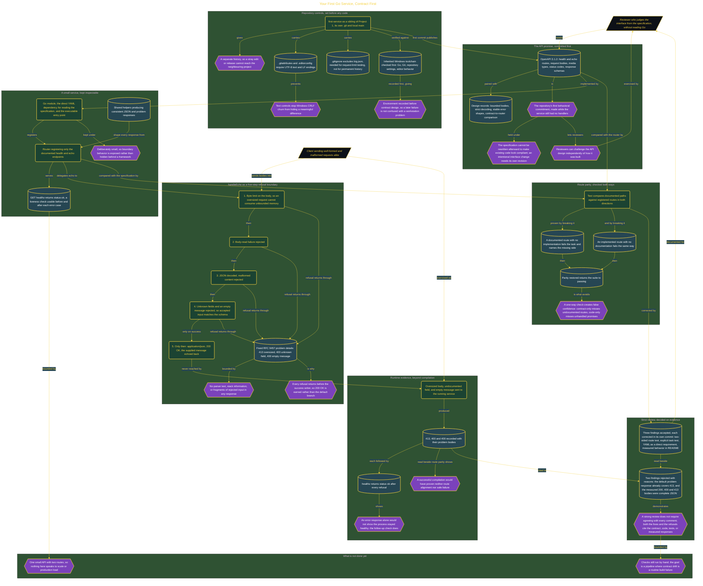

# Your First Go Service, Contract First

> Inside the [Full-Stack Systems Engineering](../../README.md) portfolio · *Application services engineered from contract to running code.*

## Overview

I built a contract-first Go service to practice defining an API before implementing its handlers. The service included health and echo endpoints, strict request validation, predictable error responses, and tests that compared the running application with its published specification. I used OpenAPI 3.1.2 to describe routes, request bodies, response codes, and schemas before adding service code. This order gave reviewers a stable promise against which they could judge the implementation. I also maintained the design records, tests, measured responses, and review decisions in Git. Documentation was therefore part of the acceptance boundary rather than a summary written after development. The completed build demonstrated how even a small API could have explicit behavior, controlled failure paths, traceable engineering decisions, and evidence capable of revealing drift between the documented contract and the service.

The architecture is built across **6 phases**, anchored by **Establishing a Contract-First Engineering Foundation** on the input side and **Completing Review and Releasing the Service** at the end. Each phase is listed in the Implementation section below.

## Architecture

The diagram shows the topology and data flow of the system as built. The full architectural narrative, with screenshots and prose, lives in [`documents/contract-first-go-service.md`](./documents/contract-first-go-service.md).

## Implementation

This system is built across **6 phases**:

1. **Establishing a Contract-First Engineering Foundation**
2. **Publishing the API Promise Before Implementation**
3. **Making the Service Behavior Visible**
4. **Engineering a Secure Echo Endpoint**
5. **Proving Contract Integrity and Safe Failures**
6. **Completing Review and Releasing the Service**

For the full walkthrough with screenshots and step-by-step content, see [`documents/contract-first-go-service.md`](./documents/contract-first-go-service.md).

## Validation

Each build phase below is documented in [`documents/contract-first-go-service.md`](./documents/contract-first-go-service.md), with screenshots, configuration, and notes as captured during the build:

- ✅ Establishing a Contract-First Engineering Foundation
- ✅ Publishing the API Promise Before Implementation
- ✅ Making the Service Behavior Visible
- ✅ Engineering a Secure Echo Endpoint
- ✅ Proving Contract Integrity and Safe Failures
- ✅ Completing Review and Releasing the Service
