# Build a Cross-Platform Go Doctor

> Inside the [Full-Stack Systems Engineering](../../README.md) portfolio · *Application services engineered from contract to running code.*

## Overview

I built a readiness doctor in Go that turns machine readiness into an executable result rather than a verbal statement that the laptop looks ready. The doctor is written to be cross-platform, and that is a design property rather than a demonstrated one: this run recorded Windows as the tested operating system, and a second supported platform is named as the next goal, with the Node and model requirements to stay unchanged when it is tried.

The supplied baseline was committed unmodified and measured at twelve lines first. I then registered three further readiness checks through the existing shared list, so the fifteen-line result is twelve inherited checks plus three I added, reached through one command and one reporting format. Keeping the registration path rather than adding a second runner is what makes the rise from twelve to fifteen inspectable instead of a claim about the whole tool.

A stricter Node rule and local model checks sit behind that total. Thinking is confirmed disabled through two separate paths, `context_length` is read so an undersized context fails visibly, and a controlled Node failure proves the doctor can return a nonzero exit code and stop delivery rather than only printing successful-looking output. The stricter version parser was bounded so it could not route around that controlled failure.

The architecture below traces the path from the preserved baseline and the tracked issue, through the three added checks and the must-fail harness, to the restored run and the issue-to-release handover whose every surface was inspected rather than inferred from the merge.

## Architecture

```mermaid
---
title: Build a Cross-Platform Go Doctor
---
%%{init: {"theme":"base","themeVariables": {"primaryColor":"#1B4332","primaryTextColor":"#F4D03F","primaryBorderColor":"#F4D03F","secondaryColor":"#264653","tertiaryColor":"#2F5233","lineColor":"#F4D03F","fontFamily":"ui-monospace, SFMono-Regular, Menlo, Consolas, monospace","fontSize":"13px"}}}%%
flowchart TD
    classDef datastore fill:#264653,stroke:#F4D03F,stroke-width:2px,color:#FFFFFF
    classDef service fill:#1B4332,stroke:#F4D03F,stroke-width:2px,color:#F4D03F
    classDef event fill:#7B42BC,stroke:#F4D03F,stroke-width:2px,color:#FFFFFF
    classDef io fill:#0d1117,stroke:#F4D03F,stroke-width:1.5px,color:#F4D03F,font-style:italic

    Teammate[/Another authorized engineer who starts from the released repository and has to reproduce the machine check without the original builder/]
    SecondOS[/The second supported operating system, untested here, where the same checks have to hold without the Node or model requirements being relaxed/]

    subgraph Goal["Readiness turned into a result rather than a statement"]
        Target[("The acceptance target: fifteen named PASS results, one controlled Node failure, and a clean recovery to exit code 0")]
        Spoken{{A laptop that appears ready is a verbal claim, where an exit code is a result another person can rerun}}
        Trail[("A private issue-to-release handover holding the source change, the failure evidence, the restored output, README instructions and a talk-track recording")]
        Independent{{The trail lets a reviewer see why the work existed, review it, rerun the doctor and confirm the released state without the builder explaining the machine}}
    end

    subgraph Baseline["A control sample preserved before anything changed"]
        Preflight(Every required tool checked before installing or changing anything)
        Ollama[("The local lane prepared and the qwen3:8b model confirmed available, with the delivery GitHub identity verified")]
        Unmodified[("The supplied baseline committed without modification and pushed to main")]
        Twelve[("The doctor run in its original state, producing a twelve-line baseline")]
        Clean{{Capturing the inherited behavior first stops existing checks being described later as work the new branch added}}
        NoDuplicates{{Checking before installing avoids adding a duplicate or hiding a missing prerequisite behind an unrelated setup change}}
    end

    subgraph Tracked["The work made visible before it was done"]
        Issue(Issue 1 created from the six acceptance criteria, its Project card moved to In Progress)
        DoctorBranch(A doctor branch keeping the implementation separate from the unchanged baseline)
        Unit{{The issue is the visible unit connecting the stated requirements to the branch, pull request, merge and release}}
    end

    subgraph Design["The structure the supplied doctor already had"]
        Shape[("Each check carrying a display name and a function that runs the validation")]
        Registry[("A shared settings slice allowing further checks to register during package initialization")]
        RunCmd[("runCmd executing a command and returning either its first output line or an error")]
        Flow(The main flow running eight tool checks, then registered settings checks, then the model checks)
        Common{{One command path serves both successful and failed execution, so tool checks report the same way}}
        Exit{{Every line prints PASS or FAIL and any failure returns exit code 1, which is what makes the doctor usable as a gate}}
    end

    subgraph Model["Checks that go past reaching the service"]
        ModelCheck(modelcheck.go loading the chat model)
        Thinking[("Thinking confirmed disabled through both the /v1 and /api/chat paths")]
        Context[("context_length read from /api/ps, so an undersized context fails visibly")]
        NotReachable{{Reaching the local runtime does not establish that the model is correctly prepared, which is why the configuration itself is asserted}}
    end

    subgraph Added["Three checks, added without a second runner"]
        Settings(doctor/settings.go with an init function registering exactly three new readiness checks)
        Preserved{{Registering through the existing shared list keeps the supplied execution design rather than introducing a parallel runner}}
        Fifteen[("Twelve original plus three new checks: fifteen lines through one command and one reporting format")]
        OneFile[("Only doctor/settings.go committed, so the logic change is reviewable on its own")]
        NotHidden{{A focused commit stops documentation or evidence edits from carrying a logic change alongside them}}
    end

    subgraph Gate["The failure that proves the gate is real"]
        Harness(The supplied must-fail harness run against the Node check)
        Failed[("The Node check reporting FAIL and the doctor returning a nonzero exit code")]
        Recovered[("The environment restored, all fifteen checks returning PASS, exit code 0")]
        Pasted[("Both outputs pasted into README.md, with Windows recorded as the tested operating system")]
        BothHalves{{Readiness needs failing evidence as well as passing evidence, because fifteen PASS lines alone do not show the doctor can stop delivery}}
    end

    subgraph Parser["A stricter Node rule that keeps the gate intact"]
        KeptName(The existing check name and version command kept, with parsing starting only after the command succeeds)
        Absent{{Missing output stays the command error path's responsibility, so absent output is never read as a version string}}
        Malformed[("Malformed version text producing an explanatory FAIL rather than a panic")]
        Outdated[("A parsed major version below 24 producing a different failure naming the version as outdated")]
        StillFails[("The supplied fake Node command still reaching the must-fail route")]
        NoBypass{{The stricter parser does not route around the controlled failure the handover evidence depends on}}
    end

    subgraph Surfaces["Every delivery surface checked, not assumed"]
        Merged(The pull request opened with Closes #1, reviewed and merged into main)
        Done[("Issue 1 closed and the Project card moved to Done")]
        Asset[("Private release v0.1.0 opened and talk-track-v0.1.0.wav confirmed attached")]
        Status[("A status update to the engagement lead covering the restored output, the completed checks and the clearance state")]
        Agree{{Because the issue, pull request, card, release, README and status all agree, the handover does not rest on a single screen or claim}}
        OneRun{{One successful local run closes nothing by itself, so each surface was inspected rather than inferred from the merge}}
    end

    subgraph Owed["What is retained and what is still open"]
        Retained[("Local folder, private repository, Project and the local model retained so the workflow can run again")]
        Quickstart[("A README quickstart another engineer can clone and run with one command")]
        Automate{{Automating the release evidence is wanted, provided it preserves the controlled failure path and the nonzero exit behavior}}
    end

    Target -- "exists because" --> Spoken
    Target -- "evidenced by" --> Trail
    Trail -- "delivers" --> Independent
    Target -- "pursued only after" --> Preflight
    Preflight -- "gives" --> NoDuplicates
    Preflight -- "prepared" --> Ollama
    Preflight -- "then committed" --> Unmodified
    Unmodified -- "measured as" --> Twelve
    Twelve -- "establishes" --> Clean
    Unmodified -- "tracked by" --> Issue
    Issue -- "branched into" --> DoctorBranch
    Issue -- "serves as" --> Unit
    DoctorBranch -- "built on" --> Shape
    Shape -- "extended through" --> Registry
    Shape -- "executes via" --> RunCmd
    RunCmd -- "gives" --> Common
    Registry -- "consumed by" --> Flow
    Flow -- "enforces" --> Exit
    Flow -- "ends with" --> ModelCheck
    ModelCheck -- "asserts" --> Thinking
    ModelCheck -- "reads" --> Context
    Ollama -- "is what ModelCheck loads from" --> ModelCheck
    Context -- "is why" --> NotReachable
    Registry -- "used by" --> Settings
    Settings -- "gives" --> Preserved
    Settings -- "raising the count to" --> Fifteen
    Clean -- "is what makes the rise to Fifteen inspectable" --> Fifteen
    Settings -- "committed as" --> OneFile
    OneFile -- "delivers" --> NotHidden
    Fifteen -- "then tested by" --> Harness
    Harness -- "produced" --> Failed
    Exit -- "is what Failed communicates to the shell" --> Failed
    Failed -- "followed by" --> Recovered
    Recovered -- "recorded with Failed in" --> Pasted
    Pasted -- "demonstrates" --> BothHalves
    Harness -- "constrains the rewrite in" --> KeptName
    KeptName -- "defers to" --> Absent
    KeptName -- "returns" --> Malformed
    KeptName -- "returns" --> Outdated
    KeptName -- "verified against" --> StillFails
    StillFails -- "establishes" --> NoBypass
    BothHalves -- "is what NoBypass protects" --> NoBypass
    Pasted -- "merged through" --> Merged
    Merged -- "alongside" --> Done
    Merged -- "alongside" --> Asset
    Merged -- "alongside" --> Status
    Done -- "together give" --> Agree
    Asset -- "checked under" --> OneRun
    Status -- "checked under" --> OneRun
    Agree -- "is what Independent rests on" --> Independent
    Merged -- "left behind" --> Retained
    Retained -- "entered through" --> Quickstart
    Retained -- "next step held under" --> Automate
    Quickstart -- "is the entry point for" --> Teammate
    Independent -- "is what Teammate relies on" --> Teammate
    Pasted -- "names only one tested platform, leaving" --> SecondOS
    NoBypass -- "is the constraint SecondOS inherits" --> SecondOS

    class Target,Trail,Ollama,Unmodified,Twelve,Shape,Registry,RunCmd,Thinking,Context,Fifteen,OneFile,Failed,Recovered,Pasted,Malformed,Outdated,StillFails,Done,Asset,Status,Retained,Quickstart datastore
    class Preflight,Issue,DoctorBranch,Flow,ModelCheck,Settings,Harness,KeptName,Merged service
    class Spoken,Independent,Clean,NoDuplicates,Unit,Common,Exit,NotReachable,Preserved,NotHidden,BothHalves,Absent,NoBypass,Agree,OneRun,Automate event
    class Teammate,SecondOS io
```

The diagram shows the topology and data flow of the system as built. The full architectural narrative, with screenshots and prose, lives in [`documents/cross-platform-go-doctor.md`](./documents/cross-platform-go-doctor.md).

## Implementation

This system is built across **6 phases**:

1. **Establishing a Secure Forward-Deployed Workspace**
2. **Linking Readiness Work to a Visible Baseline**
3. **Building a Fifteen-Check Machine Readiness Doctor**
4. **Proving Failure Recovery and Documenting the Handover**
5. **Delivering a Private Release and Verified Handover**
6. **Enforcing the Node 24 Readiness Standard**

For the full walkthrough with screenshots and step-by-step content, see [`documents/cross-platform-go-doctor.md`](./documents/cross-platform-go-doctor.md).

## Validation

Each build phase below is documented in [`documents/cross-platform-go-doctor.md`](./documents/cross-platform-go-doctor.md), with screenshots, configuration, and notes as captured during the build:

- ✅ Establishing a Secure Forward-Deployed Workspace
- ✅ Linking Readiness Work to a Visible Baseline
- ✅ Building a Fifteen-Check Machine Readiness Doctor
- ✅ Proving Failure Recovery and Documenting the Handover
- ✅ Delivering a Private Release and Verified Handover
- ✅ Enforcing the Node 24 Readiness Standard
